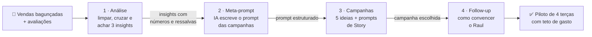
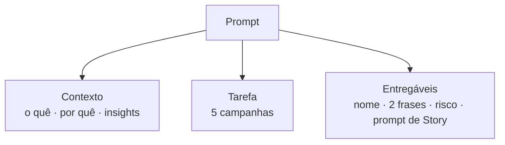
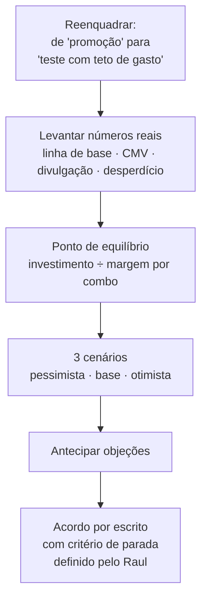

# Café Serra: dos dados bagunçados à campanha aprovada pelo sócio

Material da live. Aqui estão os prompts que usei, na ordem em que aconteceram, e o raciocínio por trás de cada um. A ideia não é que você copie os prompts como uma receita, e sim que entenda **por que** cada pedaço está ali, para adaptar ao seu caso.

> O Café Serra é um caso fictício: uma cafeteria com duas lojas (Centro e Olaria) e delivery. Os números são da base que usei na live, não de um negócio real.

---

## A história em uma linha

A dona de uma cafeteria tem **30 minutos** até uma reunião com o sócio. Ela tem uma planilha exportada do sistema, toda bagunçada, e um arquivo de avaliações de clientes. Ela sai da reunião com uma campanha escolhida e um plano para convencer o sócio mais pão-duro do mundo.

Foram três conversas com IA, e cada uma alimenta a seguinte:



O que eu quero que fique: **a saída de uma etapa vira o contexto da próxima.** Ninguém escreveu um prompt gigante do zero. Cada prompt ficou bom porque o anterior já tinha feito o trabalho pesado.

---

## Etapa 1 · Análise: limpar, cruzar e trazer 3 achados

### O ponto de partida

O arquivo de vendas veio assim (um pedacinho dele):

```text
data;loja;canal;produto;qtd;valor
01/07/2026;Centro;Balcão;Café expresso;39;R$ 253,50
2026-07-01;Centro;Balcão;Cappuccino;27;R$ 324,00
01/07/2026;Centro;Balcão;Combo Tarde;4;88.00
18/08/2026;Centro;delivery;Café expresso;10;R$ 65
01/07/2026;centro ;Delivery;Croissant;5;55.00
01/07/2026;CENTRO;Delivery;Café coado;8;R$ 56
```

Tem de tudo: data em dois formatos, `Centro` / `centro ` / `CENTRO`, `Delivery` / `delivery`, valor com `R$` e vírgula, valor com ponto (e, no arquivo original, ainda tinha quebra de linha no meio do valor, registro duplicado e campo vazio). Ou seja, o que sai de qualquer sistema de PDV de verdade.

### O prompt

```text
Sou dona do Café Serra, uma cafeteria com duas lojas (Centro e Olaria) e delivery.
Daqui a 30 minutos tenho reunião com meu sócio pra decidir o que fazer no
próximo trimestre.

Anexei dois arquivos: (1) as vendas de julho a setembro, exportadas do sistema,
e o arquivo está bagunçado; (2) as avaliações de clientes do mesmo período.

Tarefa: limpe os dados, cruze as vendas com as avaliações e me traga os 3 achados
mais importantes pro negócio. Cada achado precisa do número que o sustenta e de
um trecho de avaliação que explique o porquê.

Entrega: uma planilha com os dados limpos e um resumo por mês, loja e canal, e um
resumo de meia página pra eu ler antes da reunião.

Antes dos achados, me diga em uma linha o que você precisou corrigir nos dados.
Se algum achado tiver pouca evidência, avise.
```

### Por que ele está escrito assim

| Trecho | Por que está ali |
|---|---|
| "Daqui a 30 minutos tenho reunião" | Diz qual é o nível de profundidade certo. Ninguém quer um relatório de 20 páginas. |
| "o arquivo está bagunçado" | Avisa que limpar faz parte do trabalho, então a IA não confia cegamente no que lê. |
| "3 achados" | Limitar força a priorizar. "Me dê insights" gera uma lista de 15 coisas mornas. |
| "número que o sustenta **e** trecho de avaliação que explique o porquê" | Esse é o coração do prompt: o **quê** vem do dado e o **porquê** vem da voz do cliente. Um sem o outro é achismo ou planilha fria. |
| "me diga em uma linha o que precisou corrigir" | Transparência. Se a IA consertou algo errado, eu vejo na hora. |
| "Se algum achado tiver pouca evidência, avise" | Dá permissão explícita para ela dizer "não sei". Sem isso, tudo sai com a mesma confiança. |

### O que voltou

> **Correções nos dados:** padronizei datas, nomes das lojas, canais e valores em reais; identifiquei 25 registros duplicados e 12 campos vazios que puderam ser reconstruídos pelos preços unitários.

Os 3 achados:

1. **Delivery do Centro: −31,3%** (R$ 21.814,50 → R$ 14.991,00). Nota média de 2,33/5.
   *"Cappuccino frio pela terceira vez. Vou trocar de cafeteria."*
2. **Balcão da Olaria: +15,8%** (R$ 39.254,50 → R$ 45.469,00). Nota média de 4,46/5.
   *"Melhor café da região. A equipe da Olaria é outro nível."*
3. **Cold brew: −43,5%** (736 → 416 unidades, de agosto para setembro).
   *"Cadê o cold brew? Disseram que acabou e não tem previsão."*
   ⚠️ **Evidência limitada:** os relatos sugerem falta de estoque, mas não dá para atribuir toda a queda a isso.

Além de uma planilha limpa (2.924 registros válidos, resumo por mês/loja/canal, duplicados guardados para auditoria) e um resumo de meia página.

**Repare na ressalva do cold brew.** Ela só apareceu porque o prompt pediu. E ela vai mudar o rumo da etapa 3.

---

## Etapa 2 · Meta-prompt: pedir para a IA escrever o prompt

Com os achados na mão, eu poderia pedir "me dá 5 ideias de campanha". Só que ia vir coisa genérica do tipo "faça um desconto de 10% às terças".

Então fiz outra coisa: **pedi para a IA montar o prompt para mim**, dando só o esqueleto.

### O prompt

```text
cria um prompt pra mim cujo objetivo é gerar 5 ideias de campanhas para alavancar
as vendas das lojas.

o prompt precisa de contexto (o que / porque / insights)

descrição da tarefa: 5 ideias de campanhas de marketing

entregáveis: pra cada ideia, um nome, como ela funciona em 2 frases, risco
principal, prompt para gerar um story pro instagram
```

Escrito rápido, com minúscula e sem cerimônia mesmo. O que importa é a **estrutura** que passei:



### O que voltou (o prompt gerado)

A IA expandiu o esqueleto em um prompt completo. Os trechos mais interessantes:

```text
Você é um estrategista de marketing especializado em cafeterias, varejo local e
crescimento de vendas.

[...]

Delivery do Centro: a análise inicial apontou queda de aproximadamente 31,3% no
faturamento entre julho e setembro, mas esse percentual ainda precisa ser validado
com os dados brutos.

Cold brew: as vendas caíram 43,5% de agosto para setembro. Há relatos de
indisponibilidade do produto, mas ainda não está comprovado que a falta de estoque
explica toda a queda.

[...]

Não proponha campanhas que possam aumentar a demanda de produtos indisponíveis ou
agravar problemas operacionais.

Evite ideias genéricas como simplesmente oferecer descontos.

[...]

Critérios de qualidade
- Apresente ideias variadas, evitando cinco versões da mesma promoção.
- Indique se cada campanha é mais adequada ao Centro, à Olaria ou às duas lojas.
- Considere o impacto na margem de lucro e na capacidade operacional.
- Não invente dados de vendas, orçamento ou comportamento dos clientes.
- Diferencie fatos comprovados de hipóteses ainda não validadas.

Ao final, escolha a campanha que você implementaria primeiro, justificando a
escolha em até 3 frases [...]
```

👉 O prompt completo está em [`prompts/02-prompt-campanhas.md`](prompts/02-prompt-campanhas.md).

### O pensamento por trás

- **As ressalvas da etapa 1 viajaram junto.** O "ainda precisa ser validado" e o "não está comprovado" vieram direto da análise. A incerteza não se perdeu no caminho, e isso é o que mais importa nesse encadeamento.
- **Guardrails negativos.** "Não proponha campanhas que aumentem a demanda de produtos indisponíveis." Sem essa frase, a ideia número 1 seria "Setembro do Cold Brew", divulgando justamente o produto que está em falta.
- **"Evite ideias genéricas como descontos."** Proibir o caminho óbvio força a criatividade.
- **"Escolha uma e justifique."** Cinco ideias sem recomendação viram trabalho para quem lê. Pedir uma escolha transforma a lista em decisão.
- **O objetivo final está explícito:** "apresentar as ideias ao meu sócio e escolher uma campanha para testar imediatamente". A IA sabe para quem está escrevendo.

**Por que meta-prompt?** A IA é muito boa em expandir uma estrutura em um prompt detalhado, cheio de critérios que você esqueceria (variedade, margem, capacidade operacional). Você entra com a **estrutura** e o **contexto**, e ela entra com o **acabamento**.

---

## Etapa 3 · As 5 campanhas

Colei o prompt gerado numa conversa nova (no caso, com outro modelo, o que também mostra que o prompt é portátil).

### Primeiro, ela separou fato de hipótese

Antes de qualquer ideia, veio esta tabela:

| Ponto | Status |
|---|---|
| Crescimento de 15,8% no presencial da Olaria | Fato dos dados analisados |
| Queda de 43,5% no cold brew | Fato. A causa (falta de estoque) é hipótese |
| Queda de ~31,3% no delivery do Centro | A validar com os dados brutos |
| Reclamações sobre atrasos e bebidas frias | Fato nas avaliações |
| Pouca variedade às terças à tarde no Centro | Relato de clientes, impacto não medido |

> *Por isso, nenhuma campanha destaca o cold brew ou aumenta o volume do delivery do Centro até que estoque e operação estejam resolvidos.*

Essa frase é o guardrail funcionando.

### As campanhas

| # | Campanha | Loja | Mecânica em uma linha | Risco principal |
|---|---|---|---|---|
| 1 | **Terça de Fornada** | Centro | Item exclusivo e rotativo no Combo Tarde, às terças das 14h às 18h | Operacional: divulgar e faltar o item |
| 2 | **Vizinho de Xícara** | Olaria | Cartão-convite físico, cortesia para quem é indicado e bebida para quem indica | Financeiro: custo duplo por indicação |
| 3 | **Passaporte Serra** | As duas | Carimbos por item experimentado nas duas lojas, trocados por uma experiência | Regras inconsistentes no balcão |
| 4 | **Noite do Coado** | Olaria | Degustação guiada mensal, com ingresso pago que já inclui café em grão | Poucos inscritos não pagam o custo |
| 5 | **Quentinho é no Balcão** | Centro | Incentivo para retirar no balcão em vez de pedir delivery | Gargalo pode estar na produção, não na entrega |

Cada campanha veio com um prompt de Story 9:16 completo, com cena, luz, paleta, estilo fotográfico, texto e CTA. Exemplo da Terça de Fornada:

```text
Fotografia vertical 9:16 para Instagram Story de uma cafeteria artesanal
brasileira. Cena: balcão de madeira clara em uma tarde, com uma fatia generosa de
bolo caseiro recém-saído do forno sobre prato de cerâmica artesanal, ao lado de
uma xícara de café coado fumegante. Ao fundo, desfocado, um quadro-negro escrito
à mão "Fornada da terça". Iluminação natural de fim de tarde, luz dourada lateral
entrando pela janela, sombras suaves. Paleta quente: terracota, creme, marrom café
e toques de verde-oliva. Estilo fotográfico editorial de gastronomia, profundidade
de campo rasa, textura visível do bolo e vapor do café, sensação acolhedora,
artesanal e contemporânea. Espaço livre no terço superior para texto. Texto
principal em tipografia serifada elegante: "Terça tem fornada nova no Combo
Tarde". Texto secundário menor: "Só às terças, das 14h às 18h · Café Serra
Centro". CTA em botão arredondado na parte inferior: "Passa aqui hoje à tarde".
Sem pessoas em primeiro plano, sem logotipos de terceiros.
```

👉 As 5 campanhas completas, com todos os prompts de Story, estão em [`prompts/03-campanhas-resultado.md`](prompts/03-campanhas-resultado.md).

### A escolha

> **Terça de Fornada (Centro).** Resolve um problema já apontado pelos clientes, usa um produto que já existe (o Combo Tarde), custa pouco para executar e tem resultado fácil de medir comparando as terças antes e depois.

### Repare em

- **Toda campanha conversa com um achado.** Terça de Fornada responde à reclamação de variedade, Vizinho de Xícara aproveita o ponto forte da Olaria e Quentinho é no Balcão ataca a bebida fria. Nada saiu do nada.
- **Os riscos não são de enfeite.** O risco da Terça de Fornada ("divulgar e faltar o item repete o problema do cold brew") só existe porque a análise lá da etapa 1 trouxe o cold brew.
- **Ela marcou hipóteses dentro das próprias ideias:** *"Que o cliente da Olaria vá ao Centro é hipótese: vale medir."*
- **Dica prática que veio junto:** IA de imagem erra texto longo. Gere a imagem sem texto e aplique título e CTA no Canva.

---

## Etapa 4 · O follow-up: convencer o Raul

Aqui a conversa fica humana. Na mesma conversa, mandei:

```text
meu socio, Raul, é super mão de vaca. ele acha que promoção diminui margem e vai
me questionar muito seja la qual ideia eu tentar implementar. como que eu posso
me preparar e argumentar sobre isso?
eu sei que se eu mostrar pra ele uma previsão do retorno sobre o investimento ele
costuma absorver melhor a ideia
```

### Por que essa mensagem funciona

- **Ela dá a objeção** ("acha que promoção diminui margem").
- **Ela dá a linguagem que convence essa pessoa** ("se eu mostrar ROI ele absorve melhor").

Esse segundo ponto é ouro. Você conhece seu sócio, seu chefe, seu cliente. A IA não conhece, então conte para ela.

### O que voltou

O argumento central veio logo na primeira linha:

> **A Terça de Fornada não é promoção.** Ela não dá desconto: muda o item do Combo Tarde às terças e divulga melhor. A margem por venda continua igual.

E depois um roteiro de preparação:



A conta, com **números fictícios só para mostrar a lógica**:

| Item | Valor |
|---|---|
| Margem por combo (R$ 25 − R$ 9) | R$ 16 |
| Investimento do piloto (divulgação + desperdício × 4 terças) | R$ 270 |
| **Combos extras para empatar** | **~5 por terça** |

| Cenário | Combos extras por terça | Resultado em 4 terças |
|---|---|---|
| Pessimista | 2 | −R$ 142 |
| Base | 5 | +R$ 50 |
| Otimista | 10 | +R$ 370 |

A pergunta para o Raul deixa de ser "vamos fazer uma promoção?" e vira **"você acredita que dá para vender 5 combos a mais numa terça à tarde?"**.

E o fechamento é a parte de que mais gosto: deixar o Raul definir o critério de parada. Ele deixa de ser só quem questiona e passa a ser corresponsável pelo teste.

👉 Resposta completa em [`prompts/04-convencendo-o-raul.md`](prompts/04-convencendo-o-raul.md).

---

## O que eu queria que você levasse da live

1. **Encadeie, não empilhe.** Três prompts médios, um alimentando o outro, funcionam melhor que um prompt gigante tentando fazer tudo.
2. **Peça o número e o porquê.** Dado diz o quê, a voz do cliente diz o porquê, e você precisa dos dois.
3. **Dê permissão para a IA dizer "não sei".** "Se tiver pouca evidência, avise" é uma das frases mais valiosas que você pode colocar num prompt.
4. **Carregue as ressalvas adiante.** A incerteza da etapa 1 precisa chegar até a etapa 3, senão vira certeza no meio do caminho.
5. **Guardrails negativos evitam a ideia óbvia e errada.** "Não aumente a demanda de produto em falta" salvou a campanha.
6. **Use a IA para escrever o prompt.** Você entra com a estrutura (contexto, tarefa, entregáveis), e ela entra com o acabamento.
7. **Peça uma escolha, não só opções.** "Qual você faria primeiro e por quê?" transforma lista em decisão.
8. **Conte para a IA quem você precisa convencer.** "Meu sócio é mão de vaca e gosta de ROI" muda completamente a resposta.

---

## Estrutura do repositório

```text
.
├── README.md                          ← você está aqui
└── prompts/
    ├── 01-analise-dados.md            ← prompt da análise + resposta
    ├── 02-prompt-campanhas.md         ← meta-prompt + prompt gerado (pronto para copiar)
    ├── 03-campanhas-resultado.md      ← as 5 campanhas completas com prompts de Story
    └── 04-convencendo-o-raul.md       ← follow-up e roteiro de argumentação
```

Se usar algum desses prompts no seu negócio, me conta como foi. ☕
